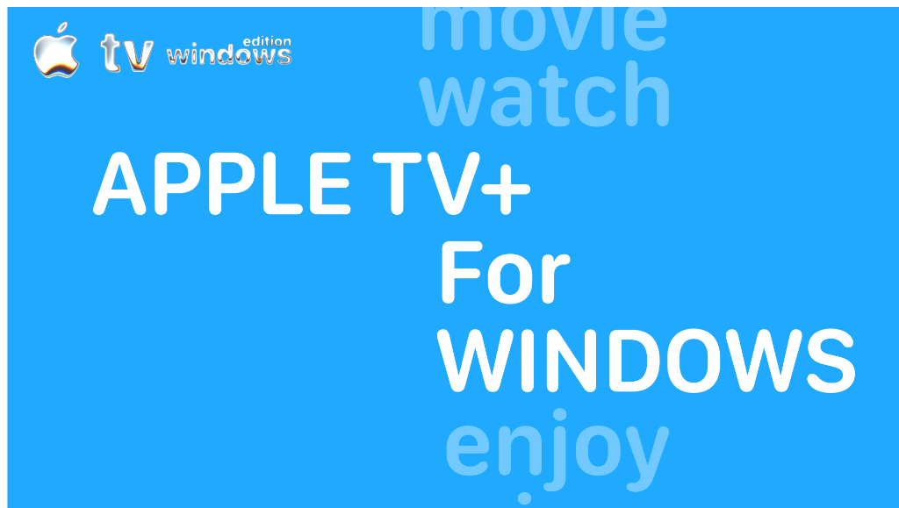

<div align="center">




# Apple TV with Liquid Glass for Windows

**Cinematic streaming brought to life in real liquid glass.**  
A lightweight, portable Apple TV desktop client for Windows 10 & 11 featuring realistic 3D liquid glass effects, rainbow light reflections, and 4K Ultra HD playback.

[-0078D6?logo=windows&logoColor=white)](https://github.com/sddsnmhjjg-ship-it/Apple-TV-with-liquid-glass-for-windows)
[-30D158?logo=speedtest&logoColor=white)](https://github.com/sddsnmhjjg-ship-it/Apple-TV-with-liquid-glass-for-windows)
[](https://tv.apple.com)
[](LICENSE)
[](https://buymeacoffee.com/ssnmhjjg)

</div>

---

## Overview

**Apple TV with Liquid Glass** brings a native, glass-inspired viewing experience to Windows users:

- **Realistic 3D Liquid Glass:** Light naturally bends around curved glass edges, giving menus and panels the look of real physical glass.
- **Rainbow Color Glints:** Subtle prism highlights along glass borders that shimmer as content moves underneath.
- **Full 4K Ultra HD & HDR Support:** Hardware-accelerated video decoding ensures silky-smooth 4K playback on compatible screens.
- **Ultra-lightweight Standalone App (~152 KB):** No heavy Electron bundles. No installer. Just download `Apple-TV-LiquidGlass.exe` and run.
- **Keeps You Signed In:** Securely saves your login session inside your personal Windows AppData folder (`%LocalAppData%\AppleTV_LiquidGlass`).

---

## Quick Start

1. Download **`Apple-TV-LiquidGlass.exe`** directly from this repository or the [Releases](https://github.com/sddsnmhjjg-ship-it/Apple-TV-with-liquid-glass-for-windows/releases) section.
2. Double-click **`Apple-TV-LiquidGlass.exe`** to launch.
3. Sign in to your Apple TV account and enjoy streaming!

> **Requirements:**
> - Windows 10 or Windows 11 (64-bit)
> - Microsoft Edge / WebView2 runtime (preinstalled on modern Windows)
> - An active Apple TV+ subscription or Apple ID to sign in.

---

## Standalone Liquid Glass Engine

This repository also includes the standalone **Liquid Glass Engine** (`liquid-glass.standalone.js` and `liquid-glass.css`), allowing you to add optical liquid glass effects to your own web projects.

### Integration

Include the stylesheet and script in your HTML:

```html
<link rel="stylesheet" href="liquid-glass.css" />
<script src="liquid-glass.standalone.js"></script>

<!-- Add liquid glass to any element with data-liquid-glass -->
<div data-liquid-glass="panel" style="padding: 24px; border-radius: 24px;">
  <h2>Liquid Glass Panel</h2>
  <button data-liquid-glass="button">Action</button>
</div>
```

See **[`LIQUID_GLASS.md`](LIQUID_GLASS.md)** for complete integration instructions, customization options, and API reference.

---

## Project Structure

```
├── Apple-TV-LiquidGlass.exe      # Windows standalone executable client
├── apple-tv-logo-orig.png         # Project logo asset
├── liquid-glass.css               # Core CSS styling for liquid glass components
├── liquid-glass.standalone.js     # Standalone optical liquid glass engine
├── LIQUID_GLASS.md                # Liquid Glass engine documentation & integration guide
├── LICENSE                        # MIT License
├── README.md                      # Project documentation
└── .gitignore                     # Git ignore rules
```

---

## Support the Creator

If you enjoy streaming your movies and TV shows through Liquid Glass, consider buying me a coffee to support future development:

<div align="center">
  <a href="https://buymeacoffee.com/ssnmhjjg" target="_blank">
    
  </a>
</div>

---

## Disclaimer

This is an independent open-source customization project. It is **not** affiliated with, endorsed by, or sponsored by Apple Inc. Apple TV, Apple TV+, and related trademarks are property of Apple Inc. and are referenced here solely for compatibility and educational purposes.

---

## License

This project is licensed under the [MIT License](LICENSE).
