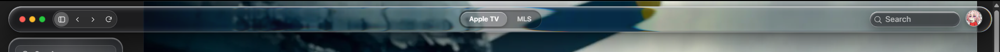
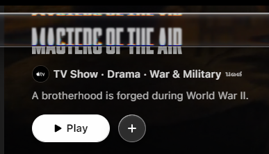

<div align="center">


# Apple TV with Liquid Glass for Windows

**Cinematic streaming brought to life in real liquid glass.**  
A lightweight, portable Apple TV desktop client for Windows 10 & 11 featuring realistic 3D liquid glass effects, rainbow light reflections, and 4K Ultra HD playback.

[-0078D6?logo=windows&logoColor=white)](https://github.com/sddsnmhjjg-ship-it/Apple-TV-with-liquid-glass-for-windows/releases)
[-30D158?logo=speedtest&logoColor=white)](https://github.com/sddsnmhjjg-ship-it/Apple-TV-with-liquid-glass-for-windows/releases)
[](https://tv.apple.com)
[](LICENSE)
[](https://buymeacoffee.com/ssnmjjg)

</div>

---

## Overview

Most web wrappers and apps simply use a flat, dark grey box. **Apple TV with Liquid Glass** upgrades your streaming experience with:

- **Realistic 3D Liquid Glass:** Light naturally bends around curved glass edges, giving menus and panels the look of real physical glass.
- **Rainbow Color Glints:** Subtle prism highlights along glass borders that shimmer as content moves underneath.
- **Full 4K Ultra HD & HDR Support:** Hardware-accelerated video decoding ensures buttery-smooth 4K playback on compatible screens.
- **Ultra-lightweight Standalone App (~141 KB):** No heavy Electron bundles. No installer. Just download the `.exe` and run.
- **Keeps You Signed In:** Securely saves your login session inside your personal Windows AppData folder (`%LocalAppData%\AppleTV_LiquidGlass`).

---

## Preview

<div align="center">
  
  <br /><br />
  
</div>

---

## Quick Start (No Setup Required)

1. Head over to the **[GitHub Releases](https://github.com/sddsnmhjjg-ship-it/Apple-TV-with-liquid-glass-for-windows/releases)** page.
2. Download **`Apple-TV-LiquidGlass.exe`**.
3. Double-click to launch!

> **Requirements:**
> - Windows 10 or Windows 11 (64-bit)
> - Microsoft Edge / WebView2 runtime (preinstalled on modern Windows)
> - An active Apple TV+ subscription or Apple ID to sign in.

---

## Interactive Web Showcase & Tuner

Want to see and customize the liquid glass physics in your browser before running the app?

Open **[`apple-tv-download.html`](apple-tv-download.html)** in any modern web browser:
- **Interactive Glass Tuner:** Move sliders in real time to adjust:
  - **Curve Rounding** (8 px – 42 px)
  - **Glass Thickness** (10 mm – 60 mm)
  - **Glass Shine** (Specular highlights)
  - **Rainbow Glint (RGB)** (Prism chromatic dispersion)
- **Shape Switcher:** Switch between Square, Circle, and Pill lens geometry.
- **Draggable Lens:** Move the glass lens freely over high-resolution scenes to watch the real-time refraction in action.

---

## How It Works

```
                                      +-------------------------------+
                                      |     Apple-TV-LiquidGlass.exe  |
                                      +---------------+---------------+
                                                      |
                                    Launches Isolated Chromium Window
                                    (Optimized flags, Widevine CDM)
                                                      |
                                                      v
                                        +----------------------------+
                                        |  Apple TV (tv.apple.com)   |
                                        |    Full 4K HDR Playback    |
                                        +--------------+-------------+
                                                       |
                              Injects Shader Extension via DevTools Protocol
                                                       |
                                                       v
                                     +----------------------------------+
                                     |  Liquid Glass Compositing Engine |
                                     |  - 3D Light Bending              |
                                     |  - Spectral Rainbow Edges        |
                                     |  - Border Specular Highlights    |
                                     +----------------------------------+
```

1. **Lightweight Launcher:** Written in C# utilizing native Windows APIs. It launches a dedicated, sandboxed browser window with hardware acceleration enabled.
2. **Widevine CDM Protection:** Automatically syncs the required DRM modules from your system Edge installation so 4K video streams without playback errors or quality drops.
3. **Liquid Glass Injection:** Injects custom shader routines directly into the DOM to render realistic optical depth and reflections on user interface elements.

---

## Compiling from Source

You do **not** need Visual Studio or external package managers to compile the binary. You can build it using the built-in Microsoft .NET C# compiler included with Windows:

```powershell
C:\Windows\Microsoft.NET\Framework64\v4.0.30319\csc.exe /target:winexe /optimize+ /out:Apple-TV-LiquidGlass.exe "apple-tv-liquid-glass\launcher\AppleTVLiquidGlassLauncher.cs"
```

The resulting `Apple-TV-LiquidGlass.exe` (~150 KB) is completely standalone and ready to run.

---

## Project Structure

```
├── Apple-TV-LiquidGlass.exe      # Compiled Windows standalone executable
├── apple-tv-download.html         # Interactive web landing page & live optics tuner
├── apple-tv-liquid-glass.html     # Minimal standalone preview demo
├── apple-tv-logo.png              # Custom Apple TV Liquid Glass logo
├── bmc-logo.svg                   # Buy Me A Coffee vector asset
├── liquid-glass.css               # Core CSS styling for liquid glass components
├── liquid-glass.standalone.js     # Standalone optical engine script
├── LIQUID_GLASS.md                # Reusable Liquid Glass engine integration docs
├── Example.png                    # Showcase preview 1
├── Example2.png                   # Showcase preview 2
├── photomode_04072026_132331.png  # Interactive demo test backdrop
├── 6zqmp-tvdz7.mp4                # Cinema background loop video
└── apple-tv-liquid-glass/
    ├── manifest.json              # Extension manifest configuration
    ├── liquid-glass.js            # Injected liquid glass shader scripts
    └── launcher/
        └── AppleTVLiquidGlassLauncher.cs  # Complete C# launcher source code
```

---

## Support the Creator

If you enjoy streaming your movies and TV shows through Liquid Glass, consider buying me a coffee to support future development and improvements:

<div align="center">
  <a href="https://buymeacoffee.com/ssnmjjg" target="_blank">
    
  </a>
</div>

---

## Disclaimer

This is an independent open-source customization project. It is **not** affiliated with, endorsed by, or sponsored by Apple Inc. Apple TV, Apple TV+, and related trademarks are property of Apple Inc. and are referenced here solely for compatibility and educational purposes.

---

## License

This project is licensed under the [MIT License](LICENSE).
